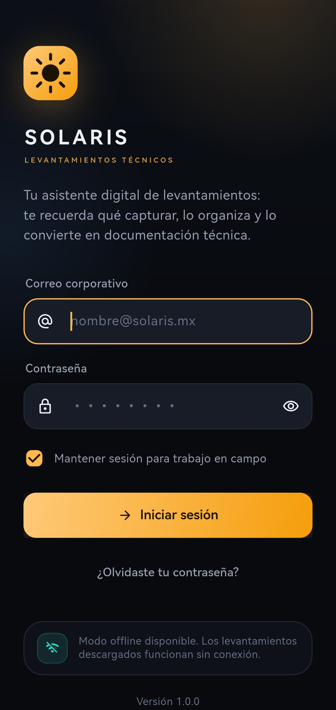
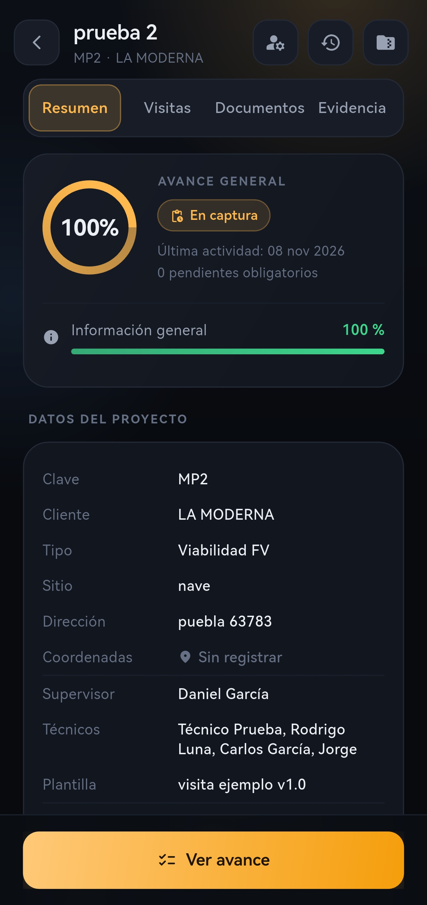
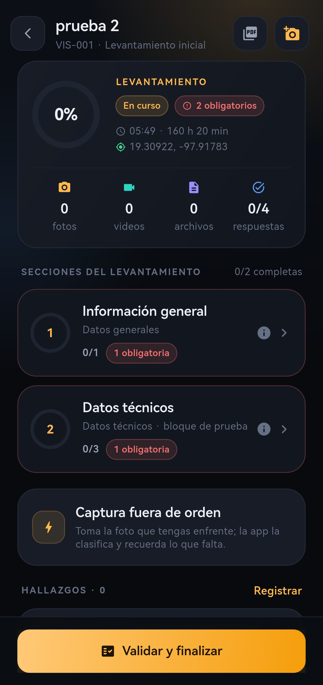
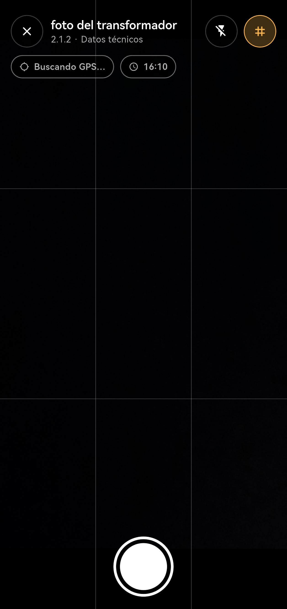

# Solaris · Levantamientos técnicos fotovoltaicos

Aplicación móvil para hacer levantamientos eléctricos de instalaciones
fotovoltaicas en campo: formulario guiado por plantilla, fotos y videos con
fecha, hora y GPS impresos, validación de pendientes, revisión del supervisor,
reporte PDF y exportación ZIP con la estructura de carpetas de la empresa.

Está hecha en **Flutter** (un solo código para Android e iOS). La parte nativa
de Android es mínima: la `MainActivity` y un procesador de video en Kotlin.

Todo se guarda primero en el teléfono (SQLite y archivos en la carpeta privada
de la app), así que se trabaja sin señal. Con conexión se sincroniza con un
proyecto de **Supabase** (base de datos PostgreSQL, Storage y cuentas).

## Capturas

| Inicio de sesión | Proyecto | Visita | Cámara |
|---|---|---|---|
|  |  |  |  |

## Qué hace

| Módulo | Detalle |
|---|---|
| **Cuentas** | Inicio de sesión con Supabase Auth. Cuatro roles: superadmin, administrador, supervisor y técnico. El superadmin crea las cuentas, les pone vigencia (fecha de inicio y fin) y puede desactivarlas o asignarles una contraseña nueva. |
| **Proyectos** | Alta en 4 pasos (datos, ubicación con GPS, equipo, plantilla y documentos). Al crear se genera la primera visita para el primer técnico asignado. |
| **Visitas** | Inicio y cierre con hora y GPS. Formulario generado desde la plantilla: preguntas condicionales, bloques repetibles (Transformador 1, 2…), guardado automático y avance por sección. |
| **Evidencia** | Fotos, videos, documentos y firma. Cada foto y video lleva impresa la fecha, la hora, las coordenadas (o `SIN GPS`) y el enlace de Google Maps. Se puede agregar texto encima de una foto. |
| **Validación** | Los pendientes obligatorios impiden cerrar la visita; el supervisor puede justificarlos. |
| **Revisión** | El supervisor aprueba la visita o pide correcciones; el técnico las atiende antes de volver a cerrar. |
| **Hallazgos** | Problemas encontrados en la visita con código (HZ-001), categoría, severidad, fotos y seguimiento. |
| **Reporte PDF** | Se genera en el teléfono, sin conexión, eligiendo qué partes incluir. |
| **Exportar ZIP** | Carpetas `01`–`06`, nombres de archivo automáticos y CSV de respuestas, mediciones, hallazgos y evidencias. |
| **Plantillas y catálogos** | El administrador edita plantillas (cada guardado es una versión nueva), tipos de proyecto y motivos de visita. |
| **Historial** | Quién cambió qué y cuándo, leído del servidor (necesita conexión). |
| **Sincronización** | Automática; sube sólo lo que cambió y respeta "Sólo con Wi-Fi" para los archivos. |

## Stack tecnológico

| Pieza | Versión |
|---|---|
| Flutter | Se compiló con 3.47.5 (canal stable). `pubspec.lock` exige `>=3.44.0`. |
| Dart | SDK `^3.12.1` (`pubspec.yaml`); se compiló con 3.13.4. |
| Android Gradle Plugin | 9.0.1 (`android/settings.gradle.kts`) |
| Kotlin (plugin Android) | 2.3.20 |
| Gradle | 9.1.0 (`android/gradle/wrapper/gradle-wrapper.properties`) |
| Java / JVM target | 17 |
| AndroidX Media3 (video nativo) | 1.9.2 |
| Backend | Supabase (`supabase_flutter` 2.18.3): PostgreSQL con RLS, Storage, Auth y 2 Edge Functions en TypeScript (Deno) |
| Base local | SQLite (`sqflite` 2.4.4) |

La lista completa de librerías está en [docs/dependencias.md](docs/dependencias.md).

## Requisitos

- **Flutter SDK** 3.44.0 o superior (probado con 3.47.5) y su Dart incluido.
- **JDK 17**: el proyecto Android compila con `JavaVersion.VERSION_17`.
- **Android SDK** con API 36 (compileSdk y targetSdk). `minSdk` es 24 (Android 7.0).
- **Android Studio Otter 3 Feature Drop (2025.2.3) o más reciente**, con el
  plugin de Flutter. Es la primera versión que admite el Android Gradle Plugin
  9.0 que usa el proyecto. En el equipo de desarrollo se usa Android Studio
  Quail 3 (2026.1.3).
- Un **teléfono Android real** para usar la cámara y el GPS; en el emulador la cámara muestra un aviso.
- Una **cuenta de Solaris** (la crea el superadmin) para iniciar sesión.

El proyecto también trae carpeta `ios/` (requiere iOS 14 o superior), pero esta
documentación se centra en Android.

## Cómo clonar, configurar y ejecutar

```bash
git clone git@github.com:mauurier/solaris.git
cd solaris
flutter pub get
flutter run            # con un teléfono Android conectado
```

- `android/local.properties` lo genera Flutter con la ruta del SDK (`flutter.sdk`);
  no se sube al repositorio.
- La URL y la llave *publishable* de Supabase tienen valores por defecto en
  `lib/core/config/supabase_config.dart`. Para apuntar a otro proyecto se
  pasan al compilar:

  ```bash
  flutter run \
    --dart-define=SUPABASE_URL=https://<project-ref>.supabase.co \
    --dart-define=SUPABASE_PUBLISHABLE_KEY=<llave-publishable>
  ```

- Para abrir sólo la parte nativa de Android, abre la carpeta `android/` en
  Android Studio.

Cómo generar el APK o AAB de release y firmarlo:
[docs/configuracion-y-build.md](docs/configuracion-y-build.md).

## Documentación

| Documento | Contenido |
|---|---|
| [docs/arquitectura.md](docs/arquitectura.md) | Patrón, capas, carpetas, flujo de datos, navegación |
| [docs/pantallas.md](docs/pantallas.md) | Cada pantalla, sus acciones y a dónde lleva |
| [docs/datos.md](docs/datos.md) | Modelos, SQLite, preferencias, Supabase (tablas, Storage, Edge Functions) |
| [docs/diagrama-er.md](docs/diagrama-er.md) | Diagrama entidad-relación de la base en Supabase |
| [docs/configuracion-y-build.md](docs/configuracion-y-build.md) | Configuración, build de release, firma y permisos |
| [docs/dependencias.md](docs/dependencias.md) | Cada librería, su versión y para qué se usa |
| [docs/manual-de-usuario.md](docs/manual-de-usuario.md) | Guía para el usuario final |
| [docs/pruebas.md](docs/pruebas.md) | Pruebas existentes y cómo correrlas |

## Licencia

El proyecto no tiene licencia de uso. La tipografía Roboto que se incluye para
el reporte PDF es Apache 2.0 (`assets/fonts/ROBOTO_LICENSE.txt`).
