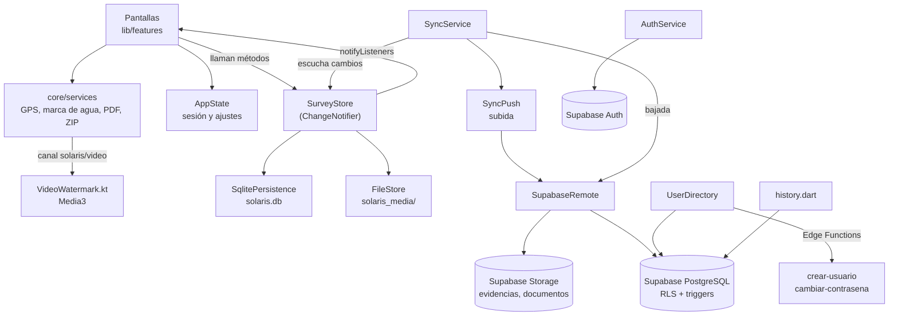

# Arquitectura

## Patrón

La app es Flutter. **No usa MVVM, MVI ni ViewModels por pantalla.** El estado
vive en unos pocos objetos globales que extienden `ChangeNotifier` (un patrón
de *store observable*). Las pantallas los leen directamente y se redibujan con
`ListenableBuilder` cuando avisan de un cambio.

| Objeto | Archivo | Responsabilidad |
|---|---|---|
| `SurveyStore` | `lib/data/survey_store.dart` | Fuente única de datos de negocio: plantillas, clientes, sitios, proyectos, visitas, respuestas, evidencias, documentos, hallazgos, revisiones y correcciones. Todas las altas, cambios y borrados pasan por aquí. |
| `AppState` | `lib/data/app_state.dart` | Sesión actual (usuario, rol, perfil) y ajustes del teléfono. |
| `SyncService` | `lib/data/sync/sync_service.dart` | Sincronización con Supabase: estado, errores y disparadores automáticos. |
| `UserDirectory` | `lib/data/auth/user_directory.dart` | Lista de cuentas (`perfil`) y altas o cambios de cuentas. |
| `AuthService` | `lib/data/auth/auth_service.dart` | Inicio y cierre de sesión con Supabase Auth. No es `ChangeNotifier`. |

La app es **offline-first**: toda escritura va primero a SQLite y a la carpeta
privada de archivos; la sincronización sube y baja después.

## Capas

```
features/   Pantallas (widgets). Leen los stores y llaman sus métodos.
   │
core/       Servicios sin estado: GPS, marca de agua, video, Maps, PDF, ZIP;
   │        tema y componentes visuales.
   │
data/       Estado y datos: stores, modelos, persistencia local, autenticación
            y sincronización con Supabase.
```

- **Presentación (`lib/features/`)**: una carpeta por módulo. Las pantallas no
  hablan con Supabase directamente, salvo dos casos que necesitan conexión:
  el historial (`lib/data/history.dart`) y la administración de cuentas
  (`UserDirectory`).
- **Servicios (`lib/core/services/`)**: funciones y clases que hacen una tarea
  concreta (generar el PDF, armar el ZIP, imprimir la marca de agua, leer el GPS).
- **Datos (`lib/data/`)**:
  - `survey_store.dart`: reglas de negocio y estado en memoria.
  - `storage/`: interfaz `Persistence` con dos implementaciones,
    `SqlitePersistence` (real) y `MemoryPersistence` (pruebas), y `FileStore`
    para los archivos.
  - `sync/`: subida (`push.dart`), bajada y servicio (`sync_service.dart`),
    conversión entre filas locales y del servidor (`remote_rows.dart`) y la
    cola de la pantalla de sincronización (`sync_queue.dart`).
  - `auth/`: sesión, perfil y directorio de usuarios.
- **Nativo Android (`android/app/src/main/kotlin/com/example/proyecto_app/`)**:
  `MainActivity.kt` registra `VideoWatermark.kt`, que procesa videos con
  Media3 por el canal `solaris/video`.
- **Servidor (`supabase/`)**: migraciones SQL (tablas, RLS, triggers, Storage)
  y Edge Functions. Detalle en [datos.md](datos.md).

## Estructura de carpetas

```
lib/
├── main.dart                     Arranque, decide entre login e inicio; helpers push()/appRoute()
├── core/
│   ├── config/supabase_config.dart   URL y llave publishable (con --dart-define)
│   ├── services/                 location_service, watermark, video_processing,
│   │                             maps, report_service (PDF), export_service (ZIP),
│   │                             formatting
│   ├── theme/                    Colores, tipografía y ThemeData (tema oscuro)
│   └── widgets/                  Componentes reutilizables (ui.dart, charts, brand,
│                                 signature_pad)
├── data/
│   ├── app_state.dart            Sesión y ajustes
│   ├── survey_store.dart         Store principal
│   ├── models.dart               Enums de rol y estados, AppUser
│   ├── catalog.dart              Catálogos editables (tipos de proyecto, motivos)
│   ├── history.dart              Lectura de la tabla historial
│   ├── remote_errors.dart        Mensajes de error para el usuario
│   ├── auth/                     auth_service, profile, user_directory
│   ├── storage/                  persistence, sqlite_persistence, file_store
│   ├── survey/                   entities, template, visit_engine
│   └── sync/                     sync_service, push, remote_rows, sync_queue
└── features/
    ├── auth/        Login
    ├── shell/       Barra inferior, botón central y sus hojas (crear, aprobar, captura rápida)
    ├── dashboard/   Inicio y desglose de evidencias/documentos
    ├── projects/    Lista, alta, detalle y documentos
    ├── visits/      Visita, secciones, preguntas, validación, revisión, nueva visita
    ├── capture/     Cámara, visor de evidencia, video, editor de texto sobre foto
    ├── findings/    Hallazgos
    ├── report/      Reporte PDF
    ├── export/      ZIP
    ├── history/     Historial
    ├── sync/        Pantalla de sincronización
    ├── profile/     Perfil y cierre de sesión
    └── admin/       Usuarios, clientes, plantillas, catálogos
```

## Inyección de dependencias

No hay framework de inyección. Cada servicio es un *singleton* con
`.instance` (`SurveyStore.instance`, `AppState.instance`,
`SyncService.instance`, `UserDirectory.instance`, `AuthService.instance`).
Para las pruebas se reemplazan puntos concretos:

- `SurveyStore.init(Persistence, FileStore)` con `MemoryPersistence`.
- `SyncService.instance.remote` (interfaz `RemoteSource`) con un servidor falso
  (`test/fake_remote.dart`).
- `historySource` (interfaz `HistorySource`) en `lib/data/history.dart`.
- `videoProcessor` (interfaz `VideoProcessor`) en
  `lib/core/services/video_processing.dart`.

## Navegación

- Navegación imperativa de Flutter (`Navigator` 1.0), **sin rutas con nombre**.
  `push(context, Pantalla())` y `appRoute()` están en `lib/main.dart`.
- `HomeShell` (`lib/features/shell/home_shell.dart`) tiene 4 pestañas en un
  `IndexedStack`: Inicio, Proyectos, Visitas y Perfil. `HomeNav` (dos
  `ValueNotifier`) permite cambiar de pestaña y fijar el filtro de Proyectos
  desde otras pantallas.
- El botón central de la barra cambia según el rol: el admin crea, el
  supervisor abre lo pendiente por aprobar y el técnico abre la captura rápida.

El mapa de pantallas está en [pantallas.md](pantallas.md).

## Flujo de datos

1. El usuario actúa en una pantalla, que llama un método del store
   (por ejemplo `SurveyStore.setAnswer`).
2. El store cambia el objeto en memoria, lo escribe en SQLite marcado como
   **pendiente** y llama `notifyListeners()`; las pantallas se redibujan.
3. `SyncService` escucha al store: 20 segundos después del último cambio, al
   volver la conexión, al regresar a la app y cada 10 minutos, sincroniza.
4. **Subida** (`SyncPush`): manda al servidor sólo las columnas que cambió el
   teléfono, comparando teléfono, *base* (cómo estaba la fila la última vez que
   coincidió con el servidor) y servidor. Si ambos cambiaron la misma columna,
   gana el cambio más reciente. Los archivos suben a Storage antes que su fila.
5. **Bajada**: pide a cada tabla lo que cambió desde la última vez
   (`actualizado_en`), lo aplica con `SurveyStore.mergeRemote` y no toca lo que
   el teléfono aún no sube.
6. Las políticas RLS y los triggers de Supabase deciden qué puede leer y
   escribir cada rol.



## Arranque

`main()` → `_Startup` (`lib/main.dart`):

1. Abre SQLite y carga el store (`SurveyStore.initDefault`).
2. Lee los ajustes (`AppState.loadSettings`).
3. Inicializa Supabase (`AuthService.init`).
4. Intenta restaurar la sesión (`AuthService.restore`). Sin conexión usa el
   perfil guardado en el teléfono.
5. Si hay sesión válida, arranca `UserDirectory` y `SyncService` y abre
   `HomeShell`; si no, `LoginScreen`. Si la cuenta está vencida o inactiva,
   abre el login con el mensaje.
