# Diagrama entidad-relación

Base de datos de Solaris en Supabase (PostgreSQL), tal como la crean las 7
migraciones de `supabase/migrations/` (la última es
`20261031080427_historial_correcciones.sql`).

## Cómo verlo

- **En GitHub:** este archivo muestra el diagrama dibujado.
- **En VS Code:** con la vista previa de Markdown y una extensión de Mermaid.
- **En [mermaid.live](https://mermaid.live):** pega el contenido de
  [`diagrama_er.txt`](diagrama_er.txt), que es el mismo diagrama con todas las
  notas como comentarios. Ahí se puede exportar a PNG o SVG.

Si cambias la base, actualiza los dos archivos.

## Diagrama

En las relaciones, `||` significa que la llave foránea es obligatoria (no
admite nulo) y `|o` que es opcional.

```mermaid
erDiagram
    %% ===== Personas y lugares =====
    auth_users {
        uuid id PK
        text email
    }
    perfil {
        uuid id PK, FK "mismo id que auth.users"
        uuid creado_por FK "quién dio de alta la cuenta"
        text email "copia de auth.users"
        text nombre
        rol_usuario rol "por defecto tecnico"
        boolean activo
        date inicio_vigencia
        date fin_vigencia "nulo = no vence"
        timestamptz creado_en
        timestamptz actualizado_en
        timestamptz eliminado_en
    }
    cliente {
        uuid id PK
        text razon_social
        text rfc UK "único entre los no borrados"
        text contacto
        timestamptz creado_en
        timestamptz actualizado_en
        timestamptz eliminado_en
    }
    sitio {
        uuid id PK
        uuid id_cliente FK
        text nombre
        text direccion
        numeric latitud
        numeric longitud
        timestamptz creado_en
        timestamptz actualizado_en
        timestamptz eliminado_en
    }

    %% ===== Catálogos y plantilla =====
    tipo_proyecto {
        uuid id PK
        text nombre UK "único entre los no borrados"
        text descripcion
        int orden
        timestamptz creado_en
        timestamptz actualizado_en
        timestamptz eliminado_en
    }
    motivo_visita {
        uuid id PK
        text nombre UK "único entre los no borrados"
        int orden
        timestamptz creado_en
        timestamptz actualizado_en
        timestamptz eliminado_en
    }
    plantilla {
        uuid id PK
        text nombre
        text tipo
        int version_mayor
        int version_menor "sube en 1 con cada edición"
        boolean activa
        jsonb definicion "secciones, grupos y preguntas"
        timestamptz creado_en
        timestamptz actualizado_en
        timestamptz eliminado_en
    }

    %% ===== Proyecto y visitas =====
    proyecto {
        uuid id PK
        uuid id_sitio FK
        uuid id_tipo_proyecto FK
        uuid id_supervisor FK
        uuid id_plantilla FK "plantilla por defecto"
        text codigo UK "único entre los no borrados"
        text nombre
        text descripcion
        timestamptz fecha_programada
        estado_trabajo estado "por defecto asignado"
        timestamptz creado_en
        timestamptz actualizado_en
        timestamptz eliminado_en
    }
    proyecto_tecnico {
        uuid id_proyecto PK, FK
        uuid id_tecnico PK, FK
        timestamptz creado_en
        timestamptz actualizado_en
        timestamptz eliminado_en
    }
    visita {
        uuid id PK
        uuid id_proyecto FK
        uuid id_tecnico FK
        uuid id_supervisor FK
        uuid id_motivo FK "nulo en la primera visita"
        uuid id_plantilla FK
        int numero "único por proyecto"
        timestamptz fecha_programada
        timestamptz fecha_inicio
        timestamptz fecha_fin
        numeric lat_inicio
        numeric lng_inicio
        numeric lat_fin
        numeric lng_fin
        estado_trabajo estado "por defecto asignado"
        text notas
        timestamptz fecha_ultima_apertura
        jsonb plantilla_usada "copia de la plantilla al capturar"
        jsonb repeticiones "cuántas copias tiene cada grupo"
        jsonb justificaciones "pendientes justificados"
        timestamptz creado_en
        timestamptz actualizado_en
        timestamptz eliminado_en
    }

    %% ===== Captura en campo =====
    respuesta {
        uuid id PK
        uuid id_visita FK
        text clave_grupo
        int numero_repeticion "desde 0"
        text clave_pregunta
        text valor
        timestamptz creado_en
        timestamptz actualizado_en
        timestamptz eliminado_en
    }
    hallazgo {
        uuid id PK
        uuid id_visita FK
        uuid id_usuario FK
        text codigo "HZ-001, único por visita"
        categoria_hallazgo categoria
        text descripcion
        severidad severidad
        text ubicacion
        text recomendacion
        estado_hallazgo estado "por defecto abierto"
        numeric latitud
        numeric longitud
        timestamptz creado_en
        timestamptz actualizado_en
        timestamptz eliminado_en
    }
    evidencia {
        uuid id PK
        uuid id_visita FK
        uuid id_usuario FK
        uuid id_hallazgo FK "opcional"
        text clave_grupo
        int numero_repeticion
        text clave_pregunta
        tipo_evidencia tipo
        text ruta_archivo UK "bucket evidencias"
        text hash_archivo
        text mime_type
        bigint tamano "bytes"
        text nombre_original
        timestamptz fecha_captura
        numeric latitud
        numeric longitud
        text comentario
        boolean importada
        timestamptz subido_en "nulo = falta subir a Storage"
        timestamptz creado_en
        timestamptz actualizado_en
        timestamptz eliminado_en
    }
    documento {
        uuid id PK
        uuid id_proyecto FK
        uuid id_usuario FK
        categoria_documento categoria
        text ruta_archivo UK "bucket documentos"
        text mime_type
        bigint tamano "bytes"
        text nombre_original
        timestamptz subido_en "nulo = falta subir a Storage"
        timestamptz creado_en
        timestamptz actualizado_en
        timestamptz eliminado_en
    }

    %% ===== Revisión del supervisor =====
    revision {
        uuid id PK
        uuid id_visita FK
        uuid id_supervisor FK
        decision_revision decision
        text observaciones
        timestamptz creado_en
    }
    correccion {
        uuid id PK
        uuid id_revision FK
        text descripcion
        estado_correccion estado "por defecto pendiente"
        timestamptz atendida_en
        timestamptz creado_en
        timestamptz actualizado_en
        timestamptz eliminado_en
    }

    %% ===== Reportes (fase futura) =====
    plantilla_reporte {
        uuid id PK
        uuid id_cliente FK "nulo = formato general"
        text nombre
        text descripcion
        text ruta_logotipo "bucket reportes"
        jsonb diseno
        boolean activa
        timestamptz creado_en
        timestamptz actualizado_en
        timestamptz eliminado_en
    }
    reporte {
        uuid id PK
        uuid id_proyecto FK
        uuid id_visita FK "opcional: reporte de una visita"
        uuid id_plantilla_reporte FK
        uuid id_usuario FK
        int version
        text motivo_version
        estado_reporte estado "por defecto borrador"
        jsonb secciones
        text ruta_pdf "bucket reportes"
        timestamptz creado_en
        timestamptz actualizado_en
        timestamptz eliminado_en
    }

    %% ===== Trazabilidad y configuración =====
    historial {
        uuid id PK
        uuid id_usuario FK "nulo = sistema"
        uuid id_proyecto "sin llave foránea"
        uuid id_visita "sin llave foránea"
        text tabla
        uuid id_registro
        accion_historial accion
        jsonb valores_antes
        jsonb valores_despues
        text descripcion
        timestamptz creado_en
    }
    configuracion {
        text clave PK
        jsonb valor
        text descripcion
        uuid actualizado_por FK
        timestamptz actualizado_en
    }

    %% ===== Relaciones (llaves foráneas) =====
    %% ||  obligatoria (la columna no admite nulo)   |o  opcional (admite nulo)
    auth_users ||--|| perfil : "tiene"
    perfil |o--o{ perfil : "da de alta"

    cliente ||--o{ sitio : "tiene"
    sitio ||--o{ proyecto : "alberga"
    tipo_proyecto |o--o{ proyecto : "clasifica"
    perfil |o--o{ proyecto : "supervisa"
    plantilla |o--o{ proyecto : "plantilla por defecto"
    proyecto ||--o{ proyecto_tecnico : "asigna"
    perfil ||--o{ proyecto_tecnico : "está asignado"

    proyecto ||--o{ visita : "tiene"
    perfil |o--o{ visita : "realiza (técnico)"
    perfil |o--o{ visita : "supervisa"
    motivo_visita |o--o{ visita : "motiva"
    plantilla |o--o{ visita : "se captura con"

    visita ||--o{ respuesta : "registra"
    visita ||--o{ hallazgo : "detecta"
    perfil |o--o{ hallazgo : "reporta"
    visita ||--o{ evidencia : "registra"
    perfil |o--o{ evidencia : "captura"
    hallazgo |o--o{ evidencia : "se respalda con"

    proyecto ||--o{ documento : "tiene"
    perfil |o--o{ documento : "sube"

    visita ||--o{ revision : "se revisa en"
    perfil ||--o{ revision : "revisa"
    revision ||--o{ correccion : "solicita"

    cliente |o--o{ plantilla_reporte : "formato propio"
    proyecto ||--o{ reporte : "genera"
    visita |o--o{ reporte : "se reporta en"
    plantilla_reporte |o--o{ reporte : "da formato"
    perfil |o--o{ reporte : "genera"

    perfil |o--o{ historial : "realiza"
    perfil |o--o{ configuracion : "modifica"
```

## Tablas

| Grupo | Tablas |
|---|---|
| Personas y lugares | `auth_users` (es `auth.users` de Supabase), `perfil`, `cliente`, `sitio` |
| Catálogos y plantilla | `tipo_proyecto`, `motivo_visita`, `plantilla` |
| Proyecto y visitas | `proyecto`, `proyecto_tecnico`, `visita` |
| Captura en campo | `respuesta`, `hallazgo`, `evidencia`, `documento` |
| Revisión del supervisor | `revision`, `correccion` |
| Reportes | `plantilla_reporte`, `reporte` |
| Trazabilidad y configuración | `historial`, `configuracion` |

`reporte`, `plantilla_reporte` y `configuracion` están reservadas para una fase
futura: la app todavía no las usa (ver [datos.md](datos.md)).

## Tipos enumerados

| Tipo | Valores |
|---|---|
| `rol_usuario` | superadmin, admin, supervisor, tecnico |
| `estado_trabajo` (proyecto y visita) | borrador, programado, asignado, en_campo, en_captura, pendiente_sync, en_revision, con_correcciones, aprobado, cerrado |
| `tipo_evidencia` | foto, video, documento, firma |
| `categoria_documento` | recibo_cfe, unifilar, ingenieria, planos, cad, otro |
| `categoria_hallazgo` | electrico, estructural, cubierta, seguridad, termografico, documental, civil, otro |
| `severidad` | baja, media, alta, critica |
| `estado_hallazgo` | abierto, en_revision, corregido, cerrado |
| `decision_revision` | aprobada, con_correcciones |
| `estado_correccion` | pendiente, atendida |
| `estado_reporte` | borrador, final |
| `accion_historial` | crear, editar, eliminar |

## Restricciones

**Valores únicos** (además de las llaves primarias):

- `cliente.rfc`, `tipo_proyecto.nombre`, `motivo_visita.nombre` y
  `proyecto.codigo`: únicos entre los registros no borrados (`eliminado_en` nulo).
- `visita`: `(id_proyecto, numero)`.
- `respuesta`: `(id_visita, clave_grupo, numero_repeticion, clave_pregunta)`.
- `hallazgo`: `(id_visita, codigo)`.
- `evidencia.ruta_archivo` y `documento.ruta_archivo`.
- `reporte`: `(id_proyecto, id_visita, version)`.

**Validaciones (check):**

- `perfil`: `fin_vigencia` no puede ser anterior a `inicio_vigencia`, y el
  superadmin no tiene fecha de fin.
- `visita`: `numero` mayor que 0 y `fecha_fin` no anterior a `fecha_inicio`.
- `plantilla`: `version_mayor` ≥ 1 y `version_menor` ≥ 0.
- `respuesta`: `numero_repeticion` ≥ 0.
- `evidencia` y `documento`: `tamano` ≥ 0.
- `reporte`: `version` ≥ 1.

## Notas

- Al crear una cuenta en Supabase Auth, el trigger `crear_perfil` crea su fila
  en `perfil`, y `copiar_email` mantiene el correo al día.
- `eliminado_en` es borrado lógico: el registro no se borra, se marca. La
  sincronización con los teléfonos depende de eso.
- `historial` lo llena el trigger `registrar_historial` en cada alta, cambio o
  borrado. Sus columnas `id_proyecto` e `id_visita` guardan el id pero **no son
  llave foránea**, para que el historial se conserve aunque se borre el registro.
- `actualizado_en` lo actualiza el trigger `tocar_actualizado_en` en cada cambio.
- Los archivos están en Supabase Storage (buckets `evidencias`, `documentos` y
  `reportes`); `ruta_archivo`, `ruta_pdf` y `ruta_logotipo` guardan la ruta
  dentro del bucket.
- Los permisos por rol y la vigencia de las cuentas se aplican con Row Level
  Security. Detalle en [datos.md](datos.md#permisos-rls-y-triggers).
