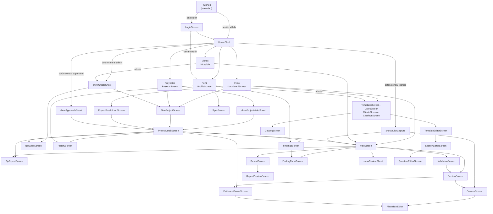

# Pantallas

La app es Flutter: **no hay Activities ni Fragments por pantalla**. En Android
existe una sola Activity (`MainActivity`, que extiende `FlutterActivity`) y
todas las pantallas son widgets de Flutter en `lib/features/`.

Tampoco hay ViewModels: en la columna **Estado** va el store que lee cada
pantalla (ver [arquitectura.md](arquitectura.md)). `SurveyStore` = datos de
negocio, `AppState` = sesión y ajustes, `SyncService` = sincronización,
`UserDirectory` = cuentas.

## Diagrama de navegación

## Resumen

| Pantalla | Archivo | Quién la usa |
|---|---|---|
| `LoginScreen` | `lib/features/auth/login_screen.dart` | Todos |
| `HomeShell` | `lib/features/shell/home_shell.dart` | Todos |
| `DashboardScreen` | `lib/features/dashboard/dashboard_screen.dart` | Todos (contenido por rol) |
| `ProjectBreakdownScreen` | `lib/features/dashboard/breakdown_screen.dart` | Admin |
| `ProjectsScreen` | `lib/features/projects/projects_screen.dart` | Todos |
| `NewProjectScreen` | `lib/features/projects/new_project_screen.dart` | Admin, supervisor |
| `ProjectDetailScreen` | `lib/features/projects/project_detail_screen.dart` | Todos |
| `VisitsTab` | `lib/features/visits/visits_tab.dart` | Todos |
| `NewVisitScreen` | `lib/features/visits/new_visit_screen.dart` | Admin, supervisor |
| `VisitScreen` | `lib/features/visits/visit_screen.dart` | Todos |
| `SectionScreen` | `lib/features/visits/section_screen.dart` | Todos |
| `ValidationScreen` | `lib/features/visits/validation_screen.dart` | Todos (admin y supervisor justifican) |
| `CameraScreen` | `lib/features/capture/camera_screen.dart` | Quien captura |
| `PhotoTextEditor` | `lib/features/capture/photo_text_editor.dart` | Quien captura |
| `EvidenceViewerScreen` | `lib/features/capture/evidence_viewer_screen.dart` | Todos |
| `FindingsScreen` | `lib/features/findings/findings_screen.dart` | Todos |
| `FindingFormScreen` | `lib/features/findings/finding_form_screen.dart` | Todos (edición según rol) |
| `ReportScreen` | `lib/features/report/report_screen.dart` | Todos |
| `ReportPreviewScreen` | `lib/features/report/report_screen.dart` | Todos |
| `ZipExportScreen` | `lib/features/export/zip_export_screen.dart` | Todos |
| `HistoryScreen` | `lib/features/history/history_screen.dart` | Todos |
| `SyncScreen` | `lib/features/sync/sync_screen.dart` | Todos |
| `ProfileScreen` | `lib/features/profile/profile_screen.dart` | Todos |
| `UsersScreen` | `lib/features/admin/users_screen.dart` | Admin (edita sólo superadmin) |
| `ClientsScreen` | `lib/features/admin/clients_screen.dart` | Admin |
| `TemplatesScreen` | `lib/features/admin/templates_screen.dart` | Admin |
| `TemplateEditorScreen` / `SectionEditorScreen` | `lib/features/admin/template_editor_screen.dart` | Admin |
| `QuestionEditorScreen` | `lib/features/admin/question_editor_screen.dart` | Admin |
| `CatalogsScreen` / `CatalogScreen` | `lib/features/admin/catalog_screen.dart` | Admin |

"Admin" incluye al superadmin: los dos usan la misma interfaz.

---

## Acceso y estructura

### LoginScreen
- **Propósito:** iniciar sesión con correo y contraseña de Supabase Auth.
- **Muestra:** campos de correo y contraseña, casilla "Mantener sesión para trabajo en campo", enlace "¿Olvidaste tu contraseña?" y versión.
- **Acciones:** iniciar sesión; "¿Olvidaste tu contraseña?" sólo muestra el aviso "Pide al superadmin que te asigne una contraseña nueva".
- **Estado:** `AuthService`, `AppState`.
- **Navega a:** `HomeShell` (reemplaza al login).

### HomeShell
- **Propósito:** estructura principal con barra inferior de 4 pestañas (Inicio, Proyectos, Visitas, Perfil) y botón central.
- **Botón central según rol:**
  - Admin: **+** abre `showCreateSheet` (nuevo proyecto o nueva visita de un proyecto existente).
  - Supervisor: **✓** con contador abre `showApprovalsSheet` (visitas finalizadas por aprobar, agrupadas por proyecto).
  - Técnico: **+** abre `showQuickCapture` (fotos y videos que faltan en la visita en curso; si hay varias en curso, primero pide elegir).
- **Estado:** `AppState`, `SurveyStore`, `HomeNav`.

## Pestañas

### DashboardScreen (Inicio)
- **Propósito:** resumen calculado con los datos del teléfono.
- **Muestra:**
  - Técnico: tarjeta de su visita reciente (continuar o abrir) e indicadores: proyectos asignados, visitas, pendientes y evidencias capturadas/requeridas de la visita reciente, documentos.
  - Supervisor: proyectos activos, por revisar, visitas en curso y pendientes.
  - Admin: proyectos, visitas en curso, pendientes, evidencias y documentos; accesos de administración (Plantillas, Usuarios, Clientes, Catálogos).
  - Todos: proyectos recientes; indicador de conexión (`ConnectionChip`), que al tocarlo pausa o reanuda la sincronización.
- **Acciones:** los indicadores llevan a Proyectos (con filtro), Visitas o al desglose; "Crear proyecto" (admin y supervisor).
- **Navega a:** `VisitScreen`, `NewProjectScreen`, `ProjectBreakdownScreen`, pantallas de administración.

### ProjectBreakdownScreen
- **Propósito:** detalle de los indicadores Evidencias y Documentos del admin.
- **Muestra:** gráfica de dona por tipo o categoría, barras por sección y lista por proyecto; selector "Todos" o un proyecto.
- **Navega a:** `ProjectDetailScreen`.

### ProjectsScreen (Proyectos)
- **Propósito:** lista de proyectos agrupados por cliente. El técnico ve sólo los asignados.
- **Muestra:** buscador, filtros por estado (el supervisor filtra por estado de seguimiento: sin asignar, sin revisar, en curso, sin programar, por iniciar, aprobados), tarjetas con estado y número de visitas.
- **Acciones:** tocar un proyecto abre una hoja con sus visitas por estado (`showProjectVisitsSheet`); botón "Nuevo proyecto" (admin y supervisor).
- **Navega a:** `ProjectDetailScreen`, `NewProjectScreen`.

### VisitsTab (Visitas)
- **Propósito:** visitas agrupadas por estado (en curso, por iniciar, finalizadas, aprobadas).
- **Muestra:** filtros por estado según el rol; buscador (admin y supervisor); filtros por técnico y por fecha (supervisor).
- **Acciones:** abrir una visita; "Nueva visita" (admin), que pide elegir el proyecto.
- **Navega a:** `VisitScreen`, `NewVisitScreen`.

### ProfileScreen (Perfil)
- **Propósito:** cuenta, preferencias y accesos.
- **Muestra:** nombre, rol, resumen de levantamientos; preferencias "Pedir comentario por fotografía" y "Sincronizar sólo con Wi-Fi"; accesos a Usuarios, Clientes y Plantillas (admin), Hallazgos, Historial, Sincronización, Almacenamiento local y Acerca de.
- **Acciones:** cerrar sesión. Antes de cerrar, `prepareSignOut` (`lib/features/profile/sign_out.dart`) sube lo pendiente y **no deja salir** si queda algo que todavía se puede subir.
- **Navega a:** `UsersScreen`, `ClientsScreen`, `TemplatesScreen`, `FindingsScreen`, `HistoryScreen`, `SyncScreen`, `LoginScreen`.

## Proyectos

### NewProjectScreen
- **Propósito:** alta de proyecto en 4 pasos: **Datos** (clave, nombre, cliente, tipo, descripción), **Ubicación** (sitio, dirección, coordenadas con botón de GPS, fecha programada), **Equipo** (supervisor y técnicos; el primero recibe la visita) y **Plantilla y documentos**.
- **Acciones:** crear cliente o tipo de proyecto desde el formulario (el tipo, sólo admin); adjuntar documentos iniciales; crear. El supervisor sólo puede asignarse a sí mismo como supervisor.
- **Estado:** `SurveyStore.createProject`, `UserDirectory`.
- **Navega a:** `ProjectDetailScreen` del proyecto creado.

### ProjectDetailScreen
- **Propósito:** ficha de un proyecto.
- **Muestra:** avance general, datos, visitas, documentos por categoría (`ProjectDocumentsPanel`), hallazgos y fotografías recientes.
- **Acciones:**
  - Admin y supervisor: cambiar supervisor y técnicos (asignación); crear visita.
  - Admin: eliminar proyecto.
  - Todos: ver historial, exportar ZIP, abrir la visita, abrir una evidencia.
- **Navega a:** `VisitScreen`, `NewVisitScreen`, `HistoryScreen`, `ZipExportScreen`, `FindingsScreen`, `EvidenceViewerScreen`.

### NewVisitScreen
- **Propósito:** visita adicional de un proyecto.
- **Muestra:** motivo (catálogo), plantilla (puede ser distinta a la del proyecto), técnico y fecha programada.
- **Acciones:** crear la visita; el admin puede agregar un motivo nuevo desde aquí.
- **Estado:** `SurveyStore.createVisit`.

## Levantamiento

### VisitScreen
- **Propósito:** levantamiento de una visita.
- **Muestra:** antes de iniciar, qué se registra al iniciar; ya iniciada, avance general, secciones con su avance, hallazgos y correcciones pendientes; historial de revisiones.
- **Acciones:**
  - "Iniciar visita": registra hora y GPS y fija la versión de la plantilla.
  - Captura fuera de orden (`showQuickCapture`), registrar hallazgo, abrir una sección.
  - Ir a validación y cierre.
  - Ya finalizada, admin o supervisor de la visita o del proyecto: "Aprobar" o "Pedir correcciones" (`showReviewSheet`).
  - Reporte PDF y exportar ZIP.
- **Navega a:** `SectionScreen`, `ValidationScreen`, `FindingFormScreen`, `ReportScreen`, `ZipExportScreen`.

### SectionScreen
- **Propósito:** una sección de la plantilla con sus bloques y preguntas (`QuestionCard` en `lib/features/visits/question_field.dart`).
- **Muestra:** preguntas de texto, número, opción única o múltiple, escala, fotos, video, documento y firma; preguntas condicionales; bloques repetibles (una instancia a la vez).
- **Acciones:** responder (se guarda solo); agregar o quitar instancias de un bloque; tomar foto o video, importar archivos; pasar a la sección siguiente.
- **Navega a:** `CameraScreen`, `EvidenceViewerScreen`, la siguiente `SectionScreen`.

### ValidationScreen
- **Propósito:** revisar pendientes antes de cerrar.
- **Muestra:** pendientes obligatorios (bloquean el cierre), opcionales y justificados.
- **Acciones:** ir a la pregunta pendiente; el admin o el supervisor justifica un obligatorio; "Finalizar" (registra hora y GPS de cierre y notas). El técnico no puede cerrar con obligatorios o correcciones sin atender.
- **Navega a:** `SectionScreen`.

### showReviewSheet (hoja)
- **Archivo:** `lib/features/visits/review_sheet.dart`.
- **Propósito:** "Aprobar visita" o "Pedir correcciones" con observaciones y la lista de lo que debe corregir.
- **Estado:** `SurveyStore.approveVisit`, `SurveyStore.requestCorrections`.

## Captura y evidencia

### CameraScreen
- **Propósito:** tomar fotos o grabar video para una pregunta o un hallazgo.
- **Muestra:** visor con cuadrícula, estado del GPS y, después de tomar, la vista previa con la marca de agua.
- **Acciones:** tomar, repetir, aceptar; agregar textos y medidas encima; comentario por foto si está activada esa preferencia.
- **Navega a:** `PhotoTextEditor`.

### PhotoTextEditor
- **Propósito:** marcar una foto con textos y líneas de medida (flecha en los dos extremos y, opcional, el valor al centro).
- **Acciones:** tocar la foto agrega un texto; "Medida" agrega una línea; arrastrar mueve el elemento tocado o un extremo de la línea; pellizcar con dos dedos en cualquier parte de la foto cambia el tamaño de lo seleccionado (letra o grosor); tocar un elemento lo edita o lo borra.
- **Guardar:** pantalla y archivo usan el mismo dibujo (`paintAnnotations`); al guardar se dibuja en la foto a su resolución real y se conserva el EXIF (fecha y GPS).

### EvidenceViewerScreen
- **Propósito:** ver una evidencia completa.
- **Muestra:** foto o video, metadatos, comentario; tocar la foto abre Google Maps en sus coordenadas.
- **Acciones:** editar comentario, abrir con otra app, y mientras la visita siga abierta, reemplazar o eliminar.

## Hallazgos

### FindingsScreen
- **Propósito:** hallazgos de un proyecto o de todos los que ve el usuario.
- **Muestra:** filtros Abiertos, Críticos, Cerrados y Todos.
- **Navega a:** `FindingFormScreen`.

### FindingFormScreen
- **Propósito:** registrar un hallazgo o darle seguimiento.
- **Muestra:** categoría, severidad, descripción, ubicación, recomendación, estado, fotos.
- **Acciones:** guardar, agregar fotos (cámara o galería), eliminar. Sólo quien revisa (admin o supervisor de la visita o del proyecto) puede cerrarlo; el técnico edita mientras su visita esté en curso.

## Reporte, exportación e historial

### ReportScreen y ReportPreviewScreen
- **Propósito:** generar el PDF de una visita en el teléfono, sin conexión.
- **Acciones:** elegir qué incluir (resumen, hallazgos, fotos, sólo lo respondido, secciones y bloques); generar; ver el PDF página por página; compartir con el menú del sistema.

### ZipExportScreen
- **Propósito:** exportar el proyecto a un ZIP con la estructura de carpetas `01`–`06` y nombres automáticos.
- **Acciones:** generar y compartir con el menú del sistema.

### HistoryScreen
- **Propósito:** quién cambió qué y cuándo, leído de la tabla `historial`. Necesita conexión.
- **Muestra:** eventos agrupados por día; filtros Todo, Visitas, Evidencias, Revisión y Proyecto; carga más al bajar.

### SyncScreen
- **Propósito:** estado de la sincronización.
- **Muestra:** estado, cola de lo que falta subir (y lo que el servidor rechazó), preferencias "Sincronización automática", "Sólo con Wi-Fi" y "Pausar sincronización".
- **Acciones:** sincronizar ahora.
- **Estado:** `SyncService`, `loadSyncQueue` (`lib/data/sync/sync_queue.dart`).

## Administración

### UsersScreen
- **Propósito:** cuentas de la tabla `perfil`. Todos los admin la ven; sólo el superadmin crea y modifica.
- **Acciones (superadmin):** crear usuario (la app genera una contraseña temporal de 12 caracteres y la muestra una sola vez); cambiar rol, estado y vigencia; asignar contraseña nueva.
- **Estado:** `UserDirectory` (Edge Functions `crear-usuario` y `cambiar-contrasena`).

### ClientsScreen
- **Propósito:** lista de clientes; alta y edición con `showClientSheet`. Los sitios se crean desde el alta de proyecto.

### TemplatesScreen, TemplateEditorScreen, SectionEditorScreen, QuestionEditorScreen
- **Propósito:** plantillas de levantamiento.
- **Acciones:** crear, duplicar, activar o desactivar y eliminar plantillas; editar secciones, bloques (repetibles o no) y preguntas (tipo, obligatoriedad, condición, carpeta y prefijo de archivo en el ZIP). El editor trabaja sobre una copia y al guardar crea una versión nueva.

### CatalogsScreen y CatalogScreen
- **Propósito:** editar los catálogos "Tipos de proyecto" y "Motivos de visita": agregar, renombrar y eliminar (no se puede eliminar un elemento en uso).
- **Acceso:** desde el Inicio del admin (accesos de administración).
